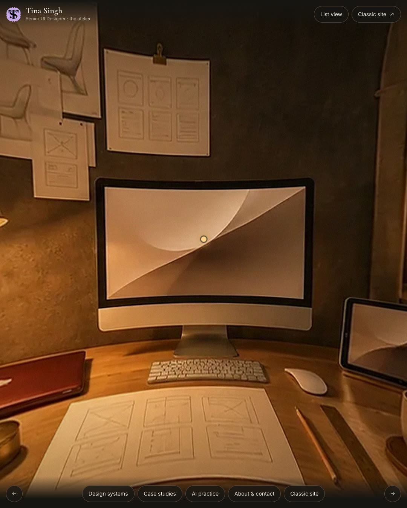

# The atelier, a 360° room

2026-11-21 · capture: `capture.jpg` (a still)



## What it is
My portfolio as a room you can stand in. You land at a desk, drag to turn around, and the things in the room open the sections of the site: design systems, case studies, AI work, about. It's one painted panorama drawn by a single WebGL shader, with HTML hotspots on top. Without JavaScript or WebGL it falls back to a plain list of the same links. Keyboard works and reduced motion is respected.

## The one thing I learned
A 360° panorama is a flat 2:1 image wrapped into a circle, so its left and right edges have to match or you see a hard seam every time you spin past the back wall. I fixed it by blending the outer band of pixels on each edge toward the other side.

## How to run
The room itself lives in my portfolio and will be linked here when it goes live. The seam fix works on any panorama:

```bash
pip install pillow
python3 room-seam.py my-panorama.jpg my-panorama-wrapped.webp 40
```

The last number is how many pixels to blend on each edge. 40 worked for a 4096-wide image.
