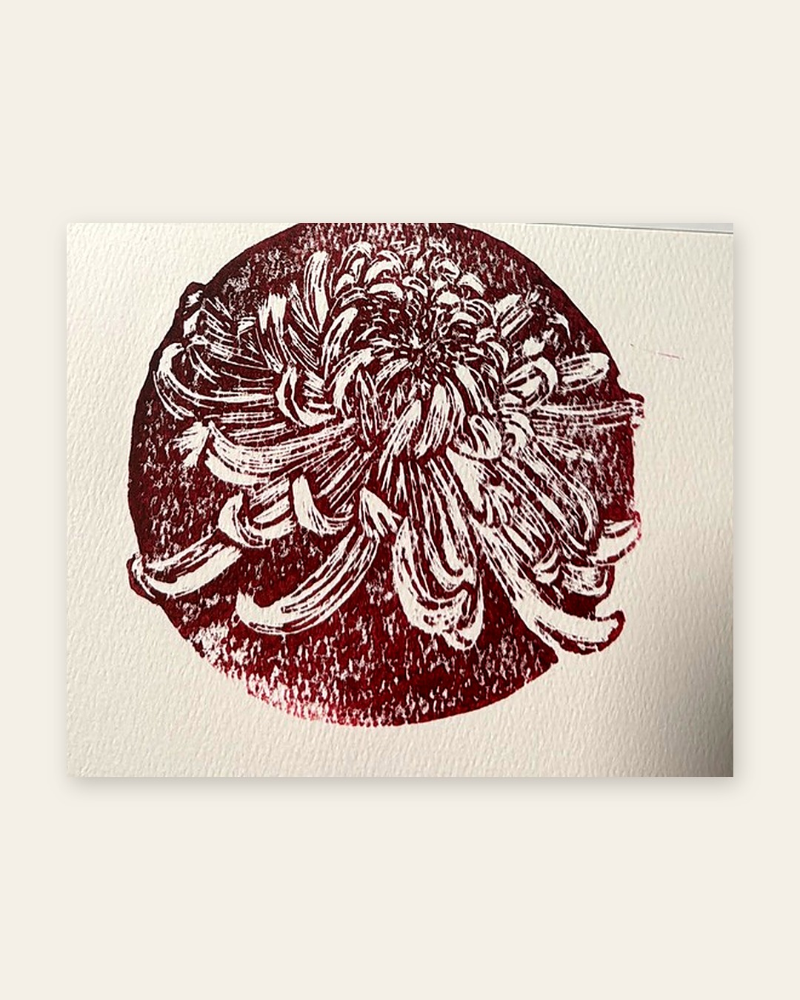

# Chrysanthemum, lino print

2026 · capture: `capture.jpg`: two prints on two papers · `capture-2.jpg`: the carved block (original photos)
Fixed for posting: `fixed.jpg`: the print on watercolour paper, cropped · `fixed-2.jpg`: the block, cropped. Crops only, colours untouched; the original photo stays as `capture.jpg`.
Write-up: none yet

## What it is
A chrysanthemum carved into a circle, every petal a separate cut. Printed in deep red on two papers. `capture-2.jpg` is the carved block.

## The one thing I learned
TODO: your words. A starting point from the photos: the paper changes the print. On textured watercolour paper the solid red breaks up into grain; on smooth paper it stays flat.

## How I made it
Hand-carved block, hand-printed on two papers. TODO: block, ink and paper names.
