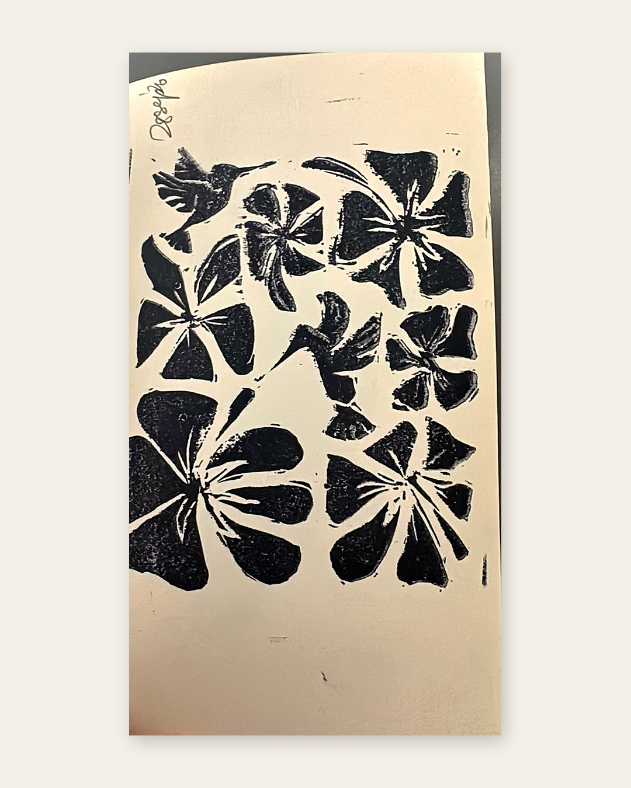

# Hummingbirds, lino print

2026 · capture: `capture.jpg` (original photo)
Fixed for posting: `fixed.jpg`: cropped to the page. Crops only, colours untouched; the original photo stays as `capture.jpg`.
Mockup: `mockup-frame.jpg` (framed on a wall).
Write-up: none yet

## What it is
Two hummingbirds among big five-petal flowers, printed in black straight into my sketchbook.

## The one thing I learned
TODO: your words. A starting point from the photos: how much the white space between shapes carries the pattern.

## How I made it
Hand-carved block, printed by hand into a sketchbook. TODO: block, ink and paper names.
