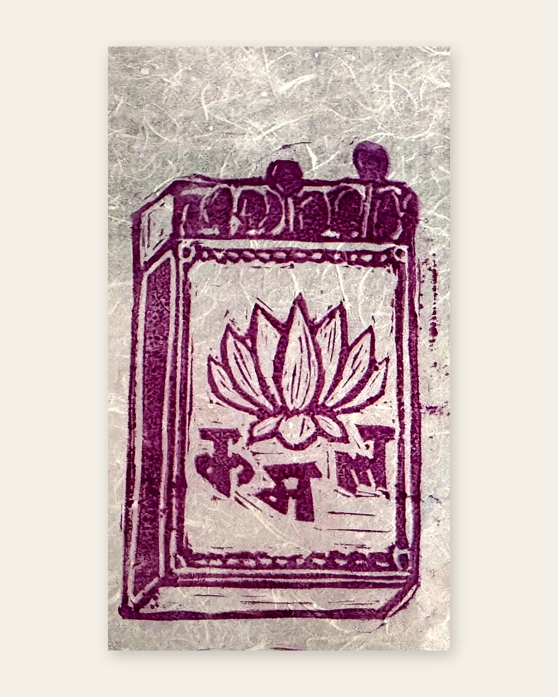

# Lotus (कमल), lino print

2026 · capture: Purple lino print of a lotus in a shrine frame with Devanagari lettering
Write-up: none yet

## What it is
A lotus in a small shrine frame, with the word कमल (lotus) in Devanagari underneath. Purple ink on fibrous paper. The second image is the block after printing, still inked, with the letters carved in reverse.

## The one thing I learned
TODO: your words. A starting point from the photos: carving lettering backwards, so it reads the right way round on paper.

## How I made it
Hand-carved soft block, hand-printed. TODO: block, ink and paper names.
