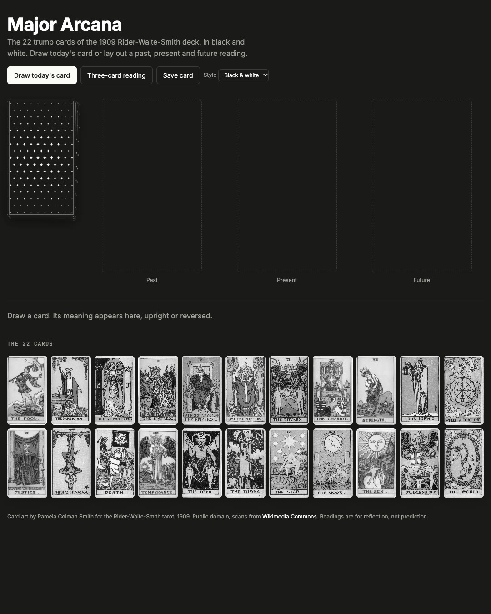

# Major Arcana

2026-11 · capture: `capture.jpg` (a still)
Write-up: none yet



## What it is
The 22 trump cards of the 1909 Rider-Waite-Smith deck. Draw today's card or lay out a past, present and future reading, with the traditional upright and reversed meanings. A style switch redraws the art as black and white, colour, ASCII, star dither, halftone or engraving, and Save card keeps the one you drew.

The card art is by Pamela Colman Smith (1909), public domain, from Wikimedia Commons. It started as Token Tarot, with cards I drew in code.

## The one thing I learned
Code-drawn art hits a ceiling. My generated cards looked like a demo. Real illustration needed real art, and the 1909 deck was sitting in the public domain the whole time.

## How to run
Open `index.html` through any local server (the cards load from the `cards/` folder):

```bash
python3 -m http.server
```

then go to http://localhost:8000.
