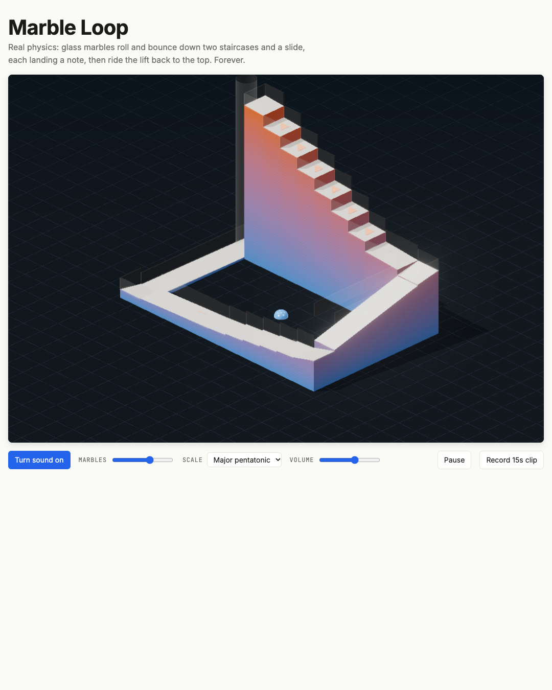

# Marble Loop

2026-11 · capture: `capture.jpg` (a still) · the page has its own Record 15s clip button
Write-up: none yet



## What it is
A satisfying loop with real physics. Glass marbles roll and bounce down two staircases and a slide, each landing plays a note, and a glass lift carries them back to the top. Forever. A safety net quietly returns any marble that stalls or escapes, so the loop never breaks. Three.js for the drawing, cannon-es for the physics.

## The one thing I learned
Every piece has to start a little lower than the one before it. Line them up exactly and the marbles stall on lips too small to see.

## How to run
Open `index.html` through any local server, for example:

```bash
python3 -m http.server
```

then go to http://localhost:8000. It loads three.js from a CDN, so it needs a connection.
