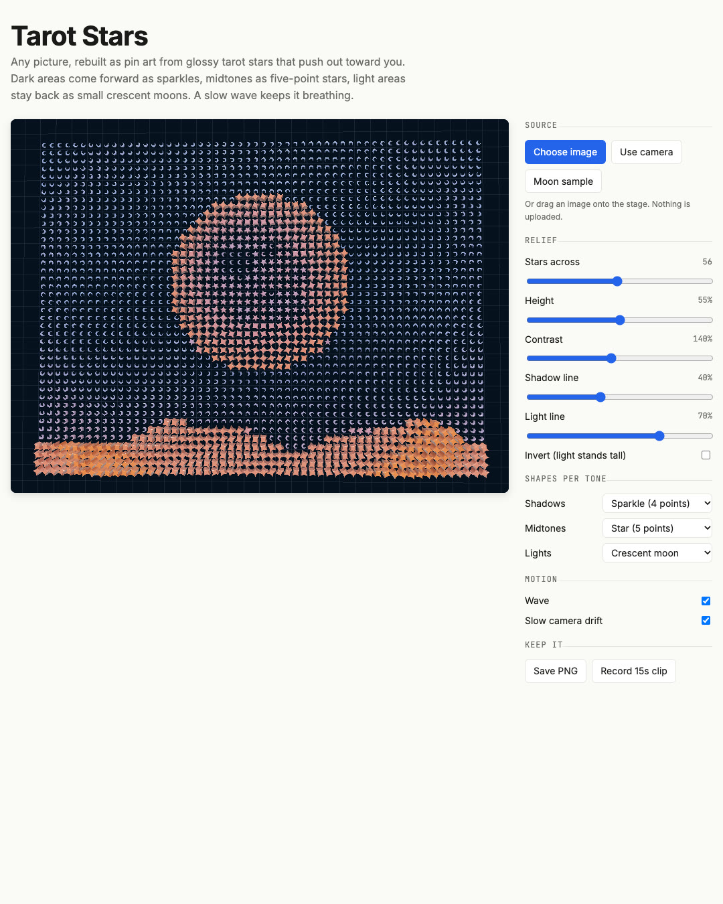

# Tarot Stars

2026-11 · capture: `capture.jpg` (a still) · the page has its own Record 15s clip button
Write-up: none yet



## What it is
Any picture, rebuilt as pin art from glossy tarot stars that push out toward you. Dark areas come forward as sparkles, midtones as five-point stars, light areas stay back as small crescent moons. A slow wave keeps it breathing. Use an image, the moon sample, or your webcam. Nothing is uploaded.

## The one thing I learned
Head-on beats clever. My first version tilted the wall at an angle because it looked more 3D, and the picture disappeared. Facing it straight on, with a raking light doing the depth, is what made it readable.

## How to run
Open `index.html` through any local server, for example:

```bash
python3 -m http.server
```

then go to http://localhost:8000. It loads three.js from a CDN, so it needs a connection. The camera needs `localhost` or https.
